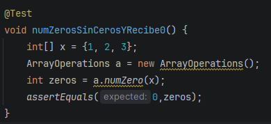
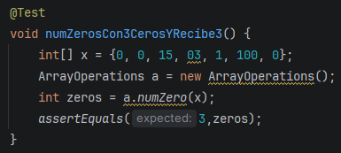
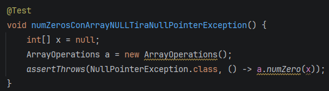
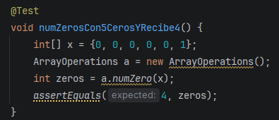
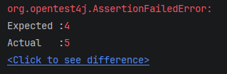
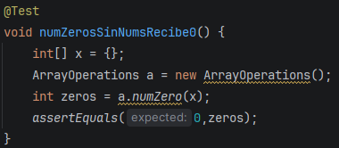
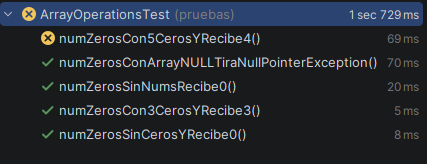

# Pruebas unitarias con JUnit

## Actividad 8

### Propósito:
- Practica el análisis y diseño de pruebas para el código fuente que se adjunta
- Verifica que tu entorno de pruebas esté correctamente configurado
- Empieza con JUnit

### Instrucción:
Considera el código que se adjunta: ArrayOperations.java.

- Desarrollar al menos 5 pruebas JUnit para evaluar el método ArrayOperations.numZero().
- Sigue las características de las buenas pruebas: Cada prueba verifica un hecho (un propósito específico permite la trazabilidad).
- Comenta los reto(s) y aprendizaje que te representó esta actividad.
- ¿Cómo utilizaste la IA? Para consultar dudas, para orientar la solución, para resolver todo (copiar y pegar), otros aspectos.

### Pruebas Unitarias del método `numZero`
#### 1. Prueba para validar si el método al recibir un arreglo sin ceros devuelva 0:

#### 2. Prueba para validar si el método al recibir un arreglo con 3 ceros devuelva 3:

#### 3. Prueba para validar si el método al recibir un arreglo nulo devuelva una excepción:

#### 4. Prueba errónea para validar si el método al recibir un arreglo con 5 ceros devuelva 4:  
  

#### 5. Prueba para validar si el método al recibir un arreglo sin números devuelva 0;

#### Resultados:  

### Retos y aprendizaje:
- No hubo retos presentados.
- Aprendí más sobre el manejo de las pruebas y la importancia de estas para verificar posibles errorés.

### Uso de IA:
- Usé IA para investigar como funciona el `assertThrows()` y como implementarlo.